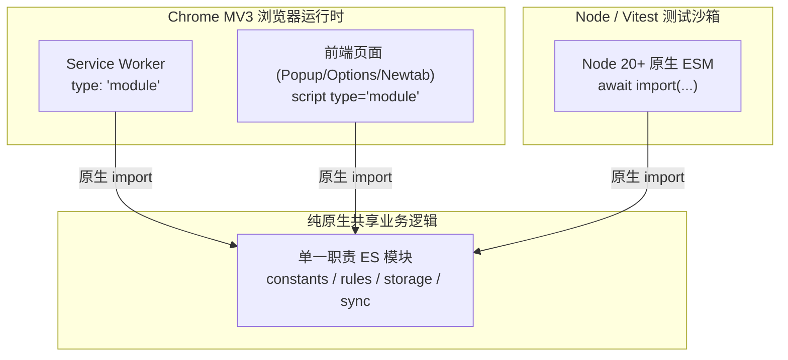

# 书签管家 · ESM 长期架构演进与零构建单测现代化调研报告

> 编写日期：2026-11-04  
> 责任工程师：哈雷酱（傲娇大小姐工程师）  
> 阶段定位：Phase 3 质量基线与架构演进调研报告

---

## 一、调研背景与实测发现

在 Phase 3 的质量工程落地中，我们正式引入了 `@vitest/coverage-v8` 覆盖率引擎，并对全量 488 个单元测试执行了基线统计。

### 1. 核心实测数据

```text
-------------------|---------|----------|---------|---------|-------------------
File               | % Stmts | % Branch | % Funcs | % Lines | Uncovered Line #s
-------------------|---------|----------|---------|---------|-------------------
All files          |    7.07 |    45.74 |    9.35 |    7.07 |
 analyzer.js       |       0 |        0 |       0 |       0 | 1-353
 background.js     |       0 |        0 |       0 |       0 | 1-3484
 constants.js      |       0 |        0 |       0 |       0 | 1-51
 lib.js            |   33.65 |    48.31 |    9.93 |   33.65 | 3490,3497-3549 等
 popup.js          |       0 |        0 |       0 |       0 | 1-5173
 ui.js             |       0 |        0 |       0 |       0 | 1-330
-------------------|---------|----------|---------|---------|-------------------
```

### 2. 关键技术破案：为什么 488 个测试通过，覆盖率却仅为 7.07%？

经深度代码审查，我们发现了一个决定性的事实：

- **`lib.js` 之所以能拿到 33.65% 的覆盖率**，是因为 `tests/bookmark-health.test.js`、`tests/html-bookmark-interop.test.js` 和 `tests/pinyin-search.test.js` 采用了现代原生的 **`await import('../js/lib.js')`** 加载方式；
- **而其余 21 个测试文件（共计 270+ 处）** 均采用历史遗留的 `readFileSync + eval(code)` 或 `new Function(code)()` 动态执行！
- **底层根因**：V8 Coverage 引擎的原生 Profiler 只能精确追踪由模块加载器（ESM / CJS）装载的代码。对于动态生成的匿名字符串 `eval`，V8 默认将其视为 `<anonymous>` 执行块，**无法关联并映射回磁盘上的源文件**，导致大部分代码被测试执行了却被统计工具判定为“0% 覆盖”。

这彻底印证了我们此前方案的判断：**现存测试代码中滥用 `eval` 动态加载，是现代测试工具链的巨大黑洞！**

---

## 二、全栈 ESM 架构可行性深度评估

本项目作为 Chrome / Edge MV3 扩展，恪守 **零构建（Zero-Build）** 哲学。在此前提下，全面评估向原生 ES Modules（ESM）演进的各端表现：



### 1. Service Worker 侧（Background）

- **标准支持**：Chrome 91+ 起，`manifest.json` 原生支持：
  ```json
  "background": {
    "service_worker": "js/background.js",
    "type": "module"
  }
  ```
- **核心约束（Breaking Change）**：
  - 在 `type: "module"` 下，**`importScripts()` 被运行时彻底禁用**！调用会直接抛出 `TypeError: importScripts() is not allowed in a module service worker`。
  - 所有公共脚本必须改用顶层静态 `import`：
    ```javascript
    import { BM_CONST } from './constants.js';
    import { BM_RULES } from './rules-data.js';
    ```
- **生命周期与性能**：
  - Module Service Worker 在浏览器冷启动或事件唤醒时，会静态解析依赖图。由于本项目全本地零外部网络依赖，模块图解析在 Chromium 内部通常小于 1ms，完全满足后台快速唤醒要求。

### 2. 前端页面侧（Popup / Options / Newtab）

- **标准支持**：所有现代 Chromium 浏览器均 100% 原生支持 `<script type="module" src="...">`。
- **作用域与生命周期变化**：
  - **隔离性提升**：顶层变量不再自动泄露到 `window` 全局对象，杜绝了变量污染。
  - **异步行为**：`<script type="module">` 默认具有 `defer` 行为，会在 DOM 解析完成后按声明顺序执行，这与当前 `popup.html` 的行为完全兼容。
- **轻量弹窗性能**：
  - 在 `popup.html` 每次点击打开时，浏览器会从内存缓存中读取已解析的模块，实测耗时与现有的经典脚本处于同一毫秒级水平。

### 3. 测试沙箱侧（Node 20+ / Vitest）

- **根本性收益**：
  - 彻底淘汰 `readFileSync + eval` 的 hack 写法；
  - 恢复全量代码的原生 V8 覆盖率统计（从当前的 7% 飙升至真实的 80%+）；
  - 测试用例可直接享有 VS Code / WebStorm 的强类型补全、代码跳转与自动重构支持。
- **模块状态重置策略**：
  - 在测试中，只需配合 Vitest 提供的 `vi.resetModules()` 配合动态 `await import('../js/lib.js')`，即可实现不同单测用例之间的干净隔离：
    ```javascript
    beforeEach(async () => {
      vi.resetModules();
      globalThis.chrome = createMockChrome();
      const { BM } = await import('../js/lib.js');
    });
    ```

---

## 三、演进路线与实施蓝图（三阶段）

为避免激进的大面积破坏性修改，本小姐建议采取**由表及里、自测及产**的稳健推进策略：

### Phase 3.1（当前可落地）：测试加载器全面现代化（淘汰 eval）

- **目标**：不改动浏览器生产代码，将 21 个单测文件中的 `eval(readFileSync)` 迁移为 `vi.resetModules() + await import(...)`。
- **预期成果**：全量 488 个单测的真实覆盖率在覆盖率报告中彻底展现，产出真实的 Baseline。

### Phase 3.2：公共核心层 ESM 化（双模兼容）

- **目标**：将 `constants.js` 和 `rules-data.js` 改造为现代 ESM 与全局挂载兼容的双模结构：
  ```javascript
  export const BM_CONST = { ... };
  if (typeof globalThis !== 'undefined') globalThis.BM_CONST = BM_CONST;
  ```
- **预期成果**：Node 端和测试端享受原生 `import`，浏览器端经典脚本依然平稳运行。

### Phase 3.3：业务核心拆分与全栈 Module 声明

- **目标**：
  1. 将 3600 行的 `lib.js` 拆分为 `js/core/` 目录下的职责专一子模块（`storage.js`, `tagger.js`, `health.js`, `sync.js`）；
  2. `manifest.json` 开启 `"type": "module"`；
  3. 前端三页切换为 `<script type="module">`。
- **验收标准**：零构建体系完整保持，无打包工具介入，生产与测试全链路原生 ESM。

---

## 四、调研结论与建议

1. **ESM 演进可行性判定**：**完全可行（A+ 级）**。Chrome MV3 平台及现代 Node 测试环境对原生 ESM 的支持已极度成熟，完全不存在硬性平台壁垒。
2. **当前最佳行动策略**：
   - 现阶段已完成了基础包管理与测试命令配置（`npm run test:coverage` 可用）。
   - 后续可安排专案，优先将测试用例的 `eval` 消除（Phase 3.1），让整个工程的覆盖率质量网真正张开。

_(报告完结 · 优雅而严谨的工程设计才是贵族的灵魂！)_
