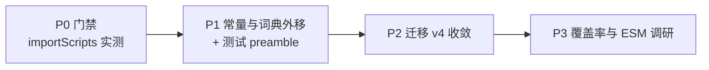

# 书签管家 (Bookmark Manager) 架构整改与演进方案 (v3.0 实测校订版)

> **文档标识**：`DOC-REFACTOR-20261104-V3`
> **基线状态**：`v1.0.2`（提交 `b97f708`）· 24 个测试文件 / **483 用例实测全绿** · CI 含 Prettier 校验（`.github/workflows/ci.yml:23`）
> **实测口径**：`wc -l`（含空行）· 核验时间 2026-11-04 10:06–10:20
> **设计准则**：KISS、DRY（单一真实源）、SOLID、零构建纯原生

---

## 修订说明（v2.0 → v3.0）

v2.0 的路线判断（原生共享脚本优于全量 ESM）成立，保留。但 v2.0 有 **11 处**与代码不符（其中 4 处会导致施工直接失败），本版逐条校订，**施工前必读附录 A 勘误表**：

> 教训小结：v2.0 失真的根因是「未在真实仓库跑一遍」——单测数、行数、测试加载方式、SW 历史结论四处均可 10 分钟内实测。本版所有数字均来自 `b97f708` 实跑。

| 项 | v2.0 说法 | v3.0 实测 | 处置 |
| :--- | :--- | :--- | :--- |
| 单测规模 | 483 | 483（实跑确认） | 保留 |
| `lib.js` 行数 | 5605 | 5660 | 已更正 |
| 迁移现状 | 仅 v<3 规则 | 另有 2 处逻辑 | 已补 |
| 双写清单 | 15+ 组键 | 漏 2 处词典 | 已补 |
| 测试影响 | 近乎零 | 274 处 eval | 已改 |
| SW 共享机制 | 直接 importScripts | 仓库记录失败过 | 加门禁 |

---

## 一、架构现实（实测复核）

### 1.1 常量并非「整齐双写」，而是「散落 + 双写」并存

`js/lib.js` 的键常量本身已分裂到 6 个互不相邻的区块，`js/background.js` 则集中在 96–134 一段。这才是可维护性差的真实成因：

| 文件 | 区块 | 内容 |
| :--- | :--- | :--- |
| `lib.js` | 2385–2390 | 标签键、`MAX_TAGS_PER_BOOKMARK`、`MAX_TAG_LEN` |
| `lib.js` | 2499–2502 | 固定池键、旧分组标记、`FALLBACK_TAG` |
| `lib.js` | 2504–2582 | `LEGACY_DEFAULT_FIXED_TAGS`、`DEFAULT_FIXED_TAGS`、`DOMAIN_TAG_RULES` |
| `lib.js` | 2860–2869 | 原生同步 9 个键 + 根目录名 |
| `lib.js` | 3228–3229 | 隐藏双键 |
| `lib.js` | 4229–4232 / 4353–4355 | 回收站常量 / 备份消息 |
| `background.js` | 96–134 | 同类键 30+ 个（含同步协议常量） |

另有一处内联字面量未提取：`lib.js:5499` 的 `'bmErrorLog'`。

### 1.2 真正会静默漂移的两处双写（v2.0 漏项）

| 位置 | 规模 | 风险 |
| :--- | :--- | :--- |
| `background.js:198-211` ↔ `lib.js:2570-2582` | 8 条域名规则，逐字一致 | 高：改一侧即漂移 |
| `background.js:213-264` ↔ `lib.js` 分类词库 | 52 行 `BACKGROUND_TAG_HINTS` | 中：语义副本 |

`DOMAIN_TAG_RULES` 是本次整改的**首要目标**——它同时被 AI 打标（`background.js:2450`）与前端打标使用，双份存在是当前唯一会产出不一致标签的地方。

### 1.3 迁移体系已闭环，v2.0 的痛点描述失实

`lib.js:5511-5535` 的现状比 v2.0 描述的更完整：

- `:5518` 读取 `bmDomainGroupsMigrated`，`:5521` 命中即短路，`:5525-5527` 写入闭环 ✅
- `:5523` 另有 `upgradeDefaultFixedTags()` 升级默认池（v2.0 未提）
- `:5526` 在 `normalizeTagRules` 中消费旧 `bmDomainGroups`

**结论**：v4 只需补「隐藏双键收敛」，不应重写分组标记逻辑。

### 1.4 测试不 import，靠 eval 加载源码（决定一切改造方式）

- `tests/lib.test.js:12-17`：`readFileSync` + `eval(code)` → 读 `globalThis.BM`
- `tests/import-guard.test.js:65` 等：`new Function(libCode)()` 同理
- 全仓 **13 个测试文件、274 处** eval / `new Function`

**推论**：`lib.js` 只要出现 `export`、或顶层直接解构 `globalThis.BM_CONST`，这批加载器立刻全红。任何「共享常量」都必须先由 harness 注入。

### 1.5 三条硬约束（不变）

- **零构建**：不引入打包器，改完刷新即生效
- **483 用例零回退**
- **最小侵入**：优先只读数据外移，不动正则编译链与调用契约

---

## 二、路线选择与 P0 门禁

### 2.1 路线对比（结论沿用 v2.0）

| 维度 | A：全量 ESM | B：原生共享脚本 |
| :--- | :--- | :--- |
| 机制 | `"type":"module"` + `export/import` | IIFE 挂 `globalThis` + 顺序加载 |
| 侵入 | 极高 | 极低 |
| 测试 | 需重写加载器 | 保留 eval，仅加 preamble |
| 裁定 | v2.x 长期目标 | **本次落地标准** |

### 2.2 P0 门禁：`importScripts` 可用性实测（施工第一件事）

`background.js:3199-3201` 记录过 `importScripts` 导致「Service worker registration failed」。该结论与规范不符（非 module 型 SW 支持 `importScripts`），最可能是**相对路径写错**：SW 文件为 `/js/background.js`，写 `importScripts('constants.js')` 会解析为 `/js/js/constants.js`。

**门禁步骤（10 分钟，不写业务代码）**：

1. 新建 `js/constants.js`，只放 `globalThis.BM_CONST = { PING: 1 }`
2. `background.js:1` 插入 `importScripts('constants.js');`（**不带 `js/` 前缀**）
3. `chrome://extensions` → 重载 → 看 SW 是否 `activated`、Console 是否报错
4. Console 执行 `BM_CONST.PING` 验证可见

**分支裁定**：

- ✅ 通过 → 走 B 全量，`background.js:3199-3201` 注释按实测结论改写（保留路径教训）
- ❌ 不通过 → 走 **B′ 降级**：前端共享 `constants.js`，SW 保留字面量块，但新增**一致性守卫测试**（读两个文件比对键值，不一致即 CI 红）。DRY 做不到，漂移可检测，仍是净收益

**门禁未过之前，不写第三章任何代码。**

---

## 三、实施方案

### 方案 1：`js/constants.js`（消除键名与限额双份）

#### 1. 归属边界（先划清，避免 v2.0 的两处归属冲突）

- `constants.js`：**键名、消息类型、数值限额、协议常量**（无业务语义）
- `rules-data.js`：**词典与规则数组**（有业务语义，见方案 2）

#### 2. 目标文件（值逐条对齐现有字面量，不新增、不臆造）

```javascript
// js/constants.js —— 零构建共享常量；经典脚本，挂 globalThis.BM_CONST
(function (global) {
  'use strict';

  const STORAGE_KEYS = Object.freeze({
    TAGS: 'bmTags',                              // lib.js:2385 / background.js:98
    HIDDEN_IDS: 'bmHiddenIds',                   // lib.js:3228 / background.js:99
    HIDDEN_URLS: 'bmHiddenUrls',                 // lib.js:3229 / background.js:102
    FIXED_TAGS: 'bmFixedTags',                   // lib.js:2499 / background.js:103
    TAG_RULES: 'bmTagRules',                     // lib.js:2500 / background.js:104
    TRASH: 'bmTrash',                            // lib.js:4229 / background.js:3206
    STORAGE_VERSION: 'bmStorageVersion',         // lib.js:5510 附近
    DOMAIN_GROUPS_MIGRATED: 'bmDomainGroupsMigrated', // lib.js:2501 / background.js:105
    STAR_HOOK: 'bmStarHook',                     // background.js:96
    AUTO_AI_TAG: 'bmAutoAiTag',                  // background.js:97
    TAG_SYNC_STATUS: 'bmTagSyncStatus',          // lib.js:2860 / background.js:113
    NATIVE_SYNC_ENABLED: 'bmNativeTagSyncEnabled',
    NATIVE_SYNC_REQUEST: 'bmNativeTagSyncRequest',
    NATIVE_SYNC_COMPLETED_REQUEST: 'bmNativeTagSyncCompletedRequest',
    NATIVE_SYNC_STATE: 'bmNativeTagSyncState',
    NATIVE_SYNC_RECORDS: 'bmNativeTagSyncRecords',
    NATIVE_SYNC_CONFIG: 'bmNativeTagSyncConfig',
    NATIVE_SYNC_CONFIG_REQUEST: 'bmNativeTagSyncConfigRequest',
    NATIVE_SYNC_URLS: 'bmNativeTagSyncUrls',
    ERROR_LOG: 'bmErrorLog'                      // lib.js:5499 内联字面量
  });

  const MESSAGES = Object.freeze({
    TAG_MUTATION: 'bmTagMutation',               // lib.js:2386 / background.js:106
    AUTO_TAG: 'bmAutoTagBookmark',               // background.js:108
    NATIVE_SYNC: 'bmNativeTagSync',              // lib.js:2865 / background.js:128
    NATIVE_SYNC_WAKE: 'wakePendingSetting',      // lib.js:2866 / background.js:129
    BACKUP_IMPORT: 'bmBackupImportBookmark',     // lib.js:4355
    TRASH_MUTATION: 'bmTrashMutation'            // lib.js:4232 / background.js:3209
  });

  const LIMITS = Object.freeze({
    FALLBACK_TAG: '其他',                        // lib.js:2502 / background.js:109
    MAX_FIXED_TAGS: 50,                          // lib.js:2566 / background.js:110
    MAX_TAGS_PER_BOOKMARK: 6,                    // lib.js:2387 / background.js:111
    MAX_TAG_LEN: 20,                             // lib.js:2388
    TRASH_MAX: 5000,                             // lib.js:4230 / background.js:3207
    TRASH_TTL_DAYS: 30,                          // lib.js:4231 / background.js:3208
    NATIVE_SYNC_PROTOCOL: 'BMN1',                // background.js:123
    NATIVE_SYNC_BUCKETS: 32,                     // background.js:124
    NATIVE_SYNC_CHUNK_CHARS: 180,                // background.js:127
    NATIVE_SYNC_ROOT_TITLE: '书签管家同步数据（请勿修改）' // lib.js:2869 / background.js:122
  });

  global.BM_CONST = Object.freeze({ STORAGE_KEYS, MESSAGES, LIMITS });
})(typeof self !== 'undefined' ? self : globalThis);
```

> ⚠️ v2.0 示例里的 `CHUNK_MAX_LENGTH: 4000`、`RECYCLE_BIN_RETENTION_DAYS` 在仓库中**不存在**，已删除。真实值为 180 字符分片、5000 条上限、30 天保留。

#### 3. 引用方式：保留原标识符（改动面最小，关键）

`TAGS_KEY` 等具名常量在 `lib.js` 用 8–13 次、在 `background.js` 用 16–38 次。改成 `BM_CONST.STORAGE_KEYS.TAGS` 会制造数百行噪音 diff。正确做法是**别名接续**：

```javascript
// lib.js 顶部（IIFE 内第一行）
const C = globalThis.BM_CONST;
const TAGS_KEY = C.STORAGE_KEYS.TAGS;          // 原标识符保留
const MAX_TAGS_PER_BOOKMARK = C.LIMITS.MAX_TAGS_PER_BOOKMARK;
// …其余同理；正文 100+ 处引用一行不改
```

```javascript
// background.js 第 1 行（门禁通过后）
importScripts('constants.js');   // 相对本文件 → /js/constants.js
const C = self.BM_CONST;
const TAGS_KEY = C.STORAGE_KEYS.TAGS;
```

**唯一允许的顶层依赖就是这两行解构**——它们必须放在 `background.js:96` 原块位置，且 `importScripts` 必须是文件第一条语句（SW 同步执行阶段）。

#### 4. 三个页面各自的加载片段（v2.0 统一用 defer 会白屏）

`newtab.html:365-369` 与 `options.html:819-821` 用的是**同步 `src`**；只有 `popup.html:490-495` 用 `defer`。必须按页现状插入，否则 defer 的 constants 会晚于同步的 lib 执行：

```html
<!-- popup.html:490 之前 -->
<script defer src="js/constants.js"></script>
<script defer src="js/lib.js"></script>
```

```html
<!-- newtab.html:365 之前（同步，与现有风格一致） -->
<script src="js/constants.js"></script>
<script src="js/lib.js"></script>
```

```html
<!-- options.html:819 之前（同步） -->
<script src="js/constants.js"></script>
<script src="js/lib.js"></script>
```

### 方案 2：`js/rules-data.js`（剥离词典，消除 2 处真实双写）

#### 1. 迁入内容（含 v2.0 漏项）

| 数据 | 源位置 | 行数 |
| :--- | :--- | :--- |
| `CATEGORY_RULES` | `lib.js:185-2162` | 1978 |
| `LEGACY_DEFAULT_FIXED_TAGS` / `DEFAULT_FIXED_TAGS` | `lib.js:2504-2564` | ~60 |
| `DOMAIN_TAG_RULES` | `lib.js:2570-2582` | 13 |
| `BACKGROUND_TAG_HINTS` | `background.js:213-264` | 52 |

`CATEGORY_MATCHERS`（`lib.js:2166`）是**算法**，留在 `lib.js`，只把源数组搬走。

#### 2. 形态与加载

```javascript
// js/rules-data.js
(function (global) {
  'use strict';
  const CATEGORY_RULES = [ /* 原 1978 行原样搬运，一个字不改 */ ];
  const LEGACY_DEFAULT_FIXED_TAGS = [ /* … */ ];
  const DEFAULT_FIXED_TAGS = [ /* … */ ];
  const DOMAIN_TAG_RULES = [ /* … */ ];
  const BACKGROUND_TAG_HINTS = [ /* … */ ];
  global.BM_RULES = Object.freeze({
    CATEGORY_RULES, LEGACY_DEFAULT_FIXED_TAGS,
    DEFAULT_FIXED_TAGS, DOMAIN_TAG_RULES, BACKGROUND_TAG_HINTS
  });
})(typeof self !== 'undefined' ? self : globalThis);
```

```html
<!-- 三页均在 lib.js 之前、constants.js 之后 -->
<script [defer] src="js/constants.js"></script>
<script [defer] src="js/rules-data.js"></script>
<script [defer] src="js/lib.js"></script>
```

`lib.js` 内改为 `const CATEGORY_RULES = globalThis.BM_RULES.CATEGORY_RULES;`——`categorizeWithHay()` 等函数体不动。

**SW 侧**：`BACKGROUND_TAG_HINTS`、`DOMAIN_TAG_RULES` 确实在 SW 中被使用（`background.js:198/2450`），门禁通过后同样 `importScripts('rules-data.js')`；门禁不通过则按 B′ 保留副本 + 守卫测试。

#### 3. 收益（按实测行数重算）

`lib.js` 5660 → 约 3600 行（−36%），且**删除的是两份重复定义的唯一副本**，收益高于单纯行数缩减。

### 方案 3：`migrateStorage()` 升级为 v4 管线

#### 1. 保留现状，只增量补双键（勘误后的正确写法）

```javascript
// lib.js:5510 区域（IIFE 内，禁用 export）
const STORAGE_VERSION = 4;   // 由 3 提升

async function migrateStorage() {
  const r = await chrome.storage.local.get([
    'bmStorageVersion',
    FIXED_TAGS_KEY,
    TAG_RULES_KEY,
    'bmDomainGroups',
    LEGACY_DOMAIN_GROUPS_MIGRATED_KEY
  ]);
  const version = Number(r.bmStorageVersion) || 0;
  if (version >= STORAGE_VERSION && r[LEGACY_DOMAIN_GROUPS_MIGRATED_KEY]) return;

  const updates = { bmStorageVersion: STORAGE_VERSION };

  // v<3：默认池与旧分组规则（现有逻辑，原样保留）
  if (version < 3 || !r[LEGACY_DOMAIN_GROUPS_MIGRATED_KEY]) {
    const upgradedTags = upgradeDefaultFixedTags(r[FIXED_TAGS_KEY]);
    if (upgradedTags !== r[FIXED_TAGS_KEY]) updates[FIXED_TAGS_KEY] = upgradedTags;
    updates[TAG_RULES_KEY] = normalizeTagRules(r[TAG_RULES_KEY], r.bmDomainGroups);
    updates[LEGACY_DOMAIN_GROUPS_MIGRATED_KEY] = true;
  }

  // v<4：隐藏双键收敛——必须重新读取，不能用上面的陈旧快照
  if (version < 4) {
    const live = await chrome.storage.local.get([HIDDEN_KEY, HIDDEN_URLS_KEY]);
    const merged = await convergeHiddenKeys(live);   // 合并，不整体覆盖
    if (merged) updates[HIDDEN_URLS_KEY] = merged;
  }

  await chrome.storage.local.set(updates);
  if (updates[FIXED_TAGS_KEY]) invalidateFixedTags();
  if (updates[TAG_RULES_KEY]) invalidateTagRules();
}
```

#### 2. 三条硬要求

1. **不用陈旧快照**：v2.0 示例在函数开头读 `HIDDEN_URLS` 再回写，而 `toggleHidden` 是高频写，迁移窗口内会覆盖用户操作。v4 段落必须 `get` 一次最新值
2. **单一入口触发**：现调用点为 `popup.js:2152`、`options.js:1098`。新增 SW 启动触发前，先做**互斥**（`chrome.storage.session` 标记或全局 Promise 单飞），否则 SW 与页面并发半程迁移
3. **幂等**：同一数据连跑两次结果必须一致；单测覆盖「无版本键 / v2 / v3 / v4 各跑两次」

### 方案 4：测试加载器改造（v2.0 称「零改动」，实际必改）

新增 `tests/helpers/load-lib.js`，作为统一 preamble：

```javascript
import { readFileSync } from 'node:fs';
import { fileURLToPath } from 'node:url';
import { dirname, join } from 'node:path';

const dir = join(dirname(fileURLToPath(import.meta.url)), '..', '..', 'js');

export function loadLib() {
  const load = (f) => eval(readFileSync(join(dir, f), 'utf-8'));
  if (!globalThis.BM_CONST) load('constants.js');
  if (!globalThis.BM_RULES) load('rules-data.js');
  load('lib.js');
  return globalThis.BM;
}
```

需适配的文件（274 处 eval / `new Function`）：`lib` `analyzer` `background-trash` `import-guard` `native-bookmark-sync` `newtab-search` `newtab-search-engine` `options-profiles` `popup-performance` `popup-resilience` `undo-delete` `ai-fixed-tags` `ui`（共 13 个）。

### 方案 5：CSS 治理（结论不变，仅校正数字）

- `css/popup.css` 实测 3843 行（v2.0 写 3844），分区注释 65 处，内部结构清晰
- 维持单文件，不拆分为数十微文件；仅当出现独立全屏面板时再拆 `css/health-inspector.css`
- 优先级 P3 可选

---

## 四、路线图与验收门禁



| 阶段 | 周期 | 关键任务 | 验收门禁 |
| :--- | :--- | :--- | :--- |
| **P0** | 0.5 天 | `importScripts` 实测，裁定 B / B′ | SW 状态 activated，`BM_CONST` 可见 |
| **P1** | 2~3 天 | 建 constants / rules-data；三页加载；13 个测试文件接 preamble | 483 绿 + 三页无 ReferenceError + 规则 hash 快照一致 |
| **P2** | 1~2 天 | v4 双键收敛、单入口互斥、幂等 | v2/v3/v4 各跑两次结果一致；隐藏键并发写不丢 |
| **P3** | 持续 | `@vitest/coverage-v8` 基线；ESM 可行性调研 | 覆盖率报表进 CI |

**P1 必加的三项冒烟**（v2.0 缺）：

1. 三个页面重载后 Console 无 `ReferenceError`
2. `CATEGORY_RULES` 内容 hash 保持不变（防搬漏、防顺手改词）
3. SW 注册成功（`chrome://extensions` 状态）

---

## 五、回退与应急预案

1. **逐步验证**：每改一个文件即跑
   ```bash
   npm test
   npm run lint
   npx prettier --check "js/**/*.js" "css/*.css" "*.html"
   ```
2. **失败定位优先于回退**：若测试报「全局变量未定义」，先确认是否漏接 preamble / 漏插 `<script>`，而非直接 `git checkout`（v2.0 的「立即撤销」会掩盖加载顺序问题）
3. **回滚点**：每个 Phase 结束打 tag；不涉及数据结构不可逆变更，检出前序提交即可回退
4. **B′ 兜底**：门禁失败时 SW 保留字面量，但一致性守卫测试必须上线，防止双写继续漂移

---

## 附录 A：v2.0 勘误表（施工依据）

| # | v2.0 位置 | 原文 | 实测 | 严重度 |
| :--- | :--- | :--- | :--- | :--- |
| 1 | `:142` `:220` | 直接 `importScripts('constants.js')` | `background.js:3199-3201` 记录该路径曾致 SW 注册失败 | 阻塞 |
| 2 | `:145-149` | 三页统一 `<script defer>` | `newtab.html:365` `options.html:819` 无 defer，会白屏 | 阻塞 |
| 3 | `:191` | `export async function migrateStorage()` | `lib.js` 是 IIFE，13 文件 274 处 eval 会 SyntaxError | 阻塞 |
| 4 | `:34` `:240` | 测试改动量接近零 | 必改 13 文件加载器 | 阻塞 |
| 5 | `:180-182` | 迁移仅处理 v<3、标记未闭环 | `lib.js:5518-5527` 已读+写闭环，`:5523` 另有升级 | 重要 |
| 6 | `:75-88` | 双写清单 15+ 键 | 漏 `DOMAIN_TAG_RULES`、`BACKGROUND_TAG_HINTS` | 重要 |
| 7 | `:119-123` | `CHUNK_MAX_LENGTH: 4000` 等 | 仓库无此常量；实际 180 / 5000 / 30 | 重要 |
| 8 | `:193-217` | 用开头快照回写隐藏键 | 高频写会丢用户操作；且双入口并发 | 重要 |
| 9 | `:173` | 5605 → 3620 行 | 5660 → 约 3600 行 | 建议 |
| 10 | `:21` | 工作区干净 | `git status` 有 2 个未跟踪 md | 建议 |
| 11 | `:254` | 测试失败立即 checkout | 掩盖加载顺序缺陷 | 建议 |
